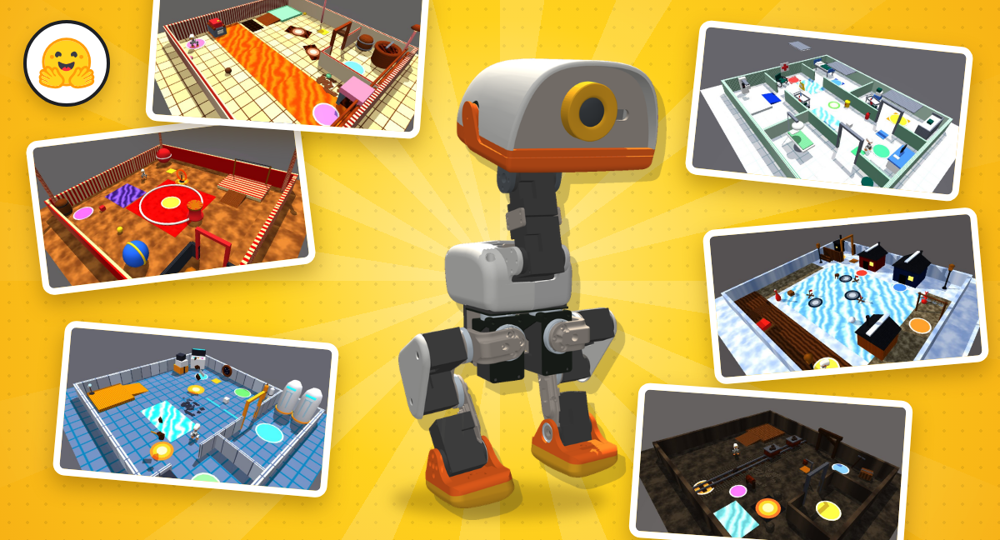
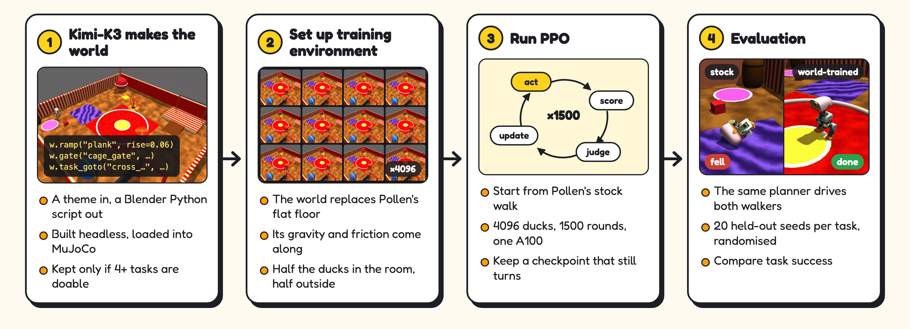

# Duck Worlds: teaching Microduck to walk in worlds an LLM built



[Kimi-K3](https://huggingface.co/moonshotai/Kimi-K3) writes complete, physically simulated worlds, as Blender Python
scripts, for [Pollen Robotics](https://pollen-robotics.com/)' 25 cm Microduck biped. Inside each world, PPO fine-tunes
Pollen's walking policy, and a CPU simulator that mirrors the robot's control loop compares the result with Pollen's stock
walk on the world's own tasks. No image or image-to-3D model is used anywhere. Everything here is in simulation.



## Results

These are the six worlds where the walker fine-tuned inside the world beat Pollen's stock walker on the world's own tasks.
Rates are mean task success over 20 held-out episodes per task, with randomised light, materials, camera, friction and
servo voltage. `scripts/results_table.py` recomputes this table from `results/eval/`.

| World | Gravity m/s² | Stock walker | World-trained |
| --- | ---: | ---: | ---: |
| Chocolate factory | 9.81 | 0.14 | 0.22 |
| Hospital corridor | 9.81 | 0.19 | 0.26 |
| Low-gravity orbital hab | 1.62 | 0.49 | 0.54 |
| Circus ring | 9.81 | 0.55 | 0.59 |
| Abandoned mine | 9.81 | 0.98 | 1.00 |
| Frozen-lake fishing village | 9.81 | 0.00 | 0.01 |

- The abandoned mine and frozen lake gains are within noise.
- The hospital average leaves out the X-ray task, which a world bug decides (see `results/recheck/`). The mine average
  leaves out *ore to bay*.
- The clearest single-task gains are *cross the greasepaint* in the circus (0.00 to 0.70), *cross the coolant* in the hab
  (0.55 to 1.00) and *restock supply room* in the hospital (0.70 to 0.95).
- Some tasks got worse: *dock the cargo* (0.95 to 0.45) and *grand parade* (0.50 to 0.05). A 100-episode re-check on fresh
  seeds confirmed both; see `results/recheck/README.md`.

Side-by-side clips of every task, stock walker left and world-trained walker right, are in the public
[clips bucket](https://huggingface.co/buckets/suvadityamuk/duck-worlds-blog-media/tree/clips).

| Hub repository | What it holds |
| --- | --- |
| [`suvadityamuk/microduck-duck-worlds-policies`](https://huggingface.co/suvadityamuk/microduck-duck-worlds-policies) | the six world-trained walking policies (ONNX) |
| [`suvadityamuk/microduck-duck-worlds`](https://huggingface.co/datasets/suvadityamuk/microduck-duck-worlds) | the six built worlds: scene, meshes, textures and Kimi-K3's script |

## Repository layout

| Path | What it is |
| --- | --- |
| `src/robo_worlds/designer.py` | Kimi-K3 design loop: theme, Blender script, build, feasibility gate, feedback |
| `src/robo_worlds/bpy_api/`, `api_doc.md` | the `rw` Blender world API Kimi-K3 writes against, and its documentation |
| `src/robo_worlds/duck_gate.py` | feasibility gate: physical checks, task reachability, stock-walker baseline |
| `src/robo_worlds/duck_scene.py` | scene.json to MuJoCo, for the CPU model and for mjlab training |
| `src/robo_worlds/duck_sim.py` | CPU simulator: BAM servos, ONNX walking policy at 50 Hz, plates and gates, task monitor, randomisation |
| `src/robo_worlds/planner.py`, `expert.py` | traversability grid, A*, pure pursuit and push controller: the planner that drives both walkers |
| `rl/duck_world_task.py`, `rl/train_world.py` | per-world mjlab task and PPO training with ONNX warm start and export |
| `scripts/make_duck_worlds.py` | generate worlds from themes with Kimi-K3 |
| `scripts/build_worlds.py` | rebuild the worlds' meshes and textures with Blender |
| `scripts/duck_jobs.py` | Hugging Face Jobs launcher: PPO training, checkpoint selection and evaluation per world |
| `scripts/select_ckpt.py`, `duck_probe.py`, `duck_eval.py` | turning probe, gated checkpoint selection, stock-vs-trained evaluation |
| `scripts/results_table.py`, `render_comparison_clips.py` | the results table and the side-by-side clips |
| `scripts/figures/` | the blog's thumbnail and figures, rendered from the simulator |
| `worlds_src/duck/<world>/` | Kimi-K3's script for each world (`final.py`), every attempt, and the full conversation |
| `worlds_src/duck_themes.json`, `_sample_toyshop.py` | the six themes, and the hand-written example world shown to Kimi-K3 |
| `worlds_duck/<world>/scene.json` | each world as built, with tasks filtered by the gate |
| `results/eval/<world>/` | the 20-episode evaluation, checkpoint selection and training settings of each run |
| `results/recheck/` | 100-episode re-check of the flagged tasks, and the X-ray world bug |

## Setup

Two environments: this project's (world generation and orchestration) and Pollen's
[`microduck_rl`](https://github.com/pollen-robotics/microduck_rl) (simulation, evaluation and training).

```bash
# 1. Pollen's stack, at the commit these results used
git clone https://github.com/pollen-robotics/microduck_rl third_party/microduck_rl
(cd third_party/microduck_rl && git checkout b02fdea && uv sync)
uv pip install --python third_party/microduck_rl/.venv/bin/python imageio imageio-ffmpeg
export DUCK=third_party/microduck_rl/.venv/bin/python

# 2. Pollen's walking policies (velstand.onnx is the stock walker and the warm start) and the six world-trained ones
hf download pollen-robotics/microduck-policies --local-dir checkpoints_cache/duck/policies
hf download suvadityamuk/microduck-duck-worlds-policies --local-dir checkpoints_cache/duck/world_policies

# 3. This project's environment
uv sync

# 4. World meshes and textures: download the built worlds...
hf download suvadityamuk/microduck-duck-worlds --repo-type dataset --local-dir worlds_duck --include "*/*"
#    ...or rebuild them from Kimi-K3's scripts (needs Blender 4.x or 5.x; set BLENDER=/path/to/blender if not on PATH)
uv run python scripts/build_worlds.py
```

Rebuilt meshes have the same vertices as the downloaded ones. Blender can triangulate a few spheres differently, which
does not change MuJoCo's collision geometry.

## Usage

**Evaluate** the stock and world-trained walkers on a world's tasks, both driven by the planner (seeds 1000-1019, as
published):

```bash
$DUCK scripts/duck_eval.py worlds_duck/a_circus_ring_with_a_sawdust_floor_a_tig --episodes 20 --videos 0 \
    --policies stock=checkpoints_cache/duck/policies/velstand.onnx \
               specialist=checkpoints_cache/duck/world_policies/a_circus_ring_with_a_sawdust_floor_a_tig.onnx \
    --out outputs/eval_circus
python scripts/results_table.py                    # the table above, from results/eval/
results/recheck/run.sh                             # the 100-episode re-check
$DUCK scripts/render_comparison_clips.py outputs/clips   # the side-by-side clips
```

**Train** locally as a smoke test (CPU, a few iterations):

```bash
$DUCK rl/train_world.py worlds_duck/a_circus_ring_with_a_sawdust_floor_a_tig --iters 3 --num-envs 8 --device cpu \
    --warm checkpoints_cache/duck/policies/velstand.onnx --out runs/smoke
```

**Train for real** on Hugging Face Jobs (one A100 per world, about an hour each). These are the published runs' flags:

```bash
uv run python scripts/duck_jobs.py bundle
uv run python scripts/duck_jobs.py train a_circus_ring_with_a_sawdust_floor_a_tig --iters 1500 --tag v3 \
    --extra "--inside-fraction 0.5 --ang-std 0.32 --ang-weight 3.0 --warm checkpoints_cache/duck/policies/velstand.onnx"
```

Each job trains, selects a checkpoint (`select_ckpt.py`), probes turning and runs the 20-episode evaluation, then uploads
everything to a private dataset in your account.

**Generate new worlds** with Kimi-K3 (needs a Hugging Face token with Inference Providers access, Blender, and the
`microduck_rl` environment for the gate). Pass your own themes file to make new ones:

```bash
uv run python scripts/make_duck_worlds.py --themes worlds_src/duck_themes.json --parallel 6
```

Run many evaluations in parallel with `ORT_THREADS=1 OMP_NUM_THREADS=1`; otherwise the processes oversubscribe threads and
run far slower.

## Things that bit us

- **Command dead band.** From standing, Pollen's stock gait ignores a 0.2 m/s forward command, and 0.3 m/s walks at about
  0.09 m/s in simulation. The planner always commands within the band that actually walks.
- **Turning on the spot.** World-trained gaits lose the stock policy's turn-in-place, so the planner turns on arcs for every
  walker, stock included.
- **Friction.** MuJoCo combines friction by taking the larger of the two geoms, so an ice floor would inherit the foot's
  grip. World surfaces carry `priority=1`, so their own friction decides the contact.
- **ONNX warm start.** The exported observation normaliser divides by std + 0.01. Subtract the epsilon when lifting the
  weights back into an rsl_rl actor, or the warm-started actor is not the policy you think it is.
- **Fine-tuning a working gait.** Keep the actor's observation normaliser frozen, warm up the new critic with the actor
  frozen, then reset the adaptive learning rate, which drifts upward while the frozen actor's KL is zero.
- **Self-shaped commands.** Closed-loop path following, steering from the robot's own pose, taught PPO to turn the wrong
  way, because the policy could shape its own commands. Robots inside the room replay open-loop command profiles instead.
- **Checkpoint drift.** Turning degraded with training length inside rooms, in a room-dependent direction. Every run picks a
  checkpoint that passes a turning probe, ranked on task success with separate seeds.
- **Coplanar seams.** A ramp that meets a platform at exactly the same height can snag the feet (the hospital X-ray task).
- **Head camera.** Its image axes are a quarter turn off in the model, and it sits inside the head shell: render with the
  robot's visual group hidden and rotate the image back.

## Credits and licences

The code in this repository is licensed under Apache-2.0 (`LICENSE`). It builds on:

- **Microduck** by [Pollen Robotics](https://pollen-robotics.com/): [`microduck_rl`](https://github.com/pollen-robotics/microduck_rl)
  (Apache-2.0 code; the robot's 3D models are CC BY-NC-SA 4.0 and are not redistributed here) and the
  [`microduck-policies`](https://huggingface.co/pollen-robotics/microduck-policies) walking policies (Apache-2.0).
- [mjlab](https://github.com/mujocolab/mjlab) and [MuJoCo](https://mujoco.org/) for simulation, and
  [rsl_rl](https://github.com/leggedrobotics/rsl_rl) for PPO.
- [BAM](https://github.com/Rhoban/bam) servo models from Rhoban.
- [Kimi-K3](https://huggingface.co/moonshotai/Kimi-K3) by Moonshot AI, via Hugging Face Inference Providers, which wrote
  every world script in `worlds_src/duck/`.
